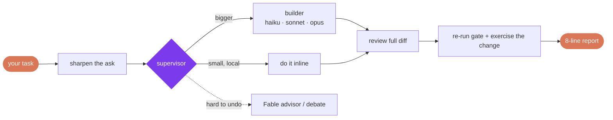

<p align="center">
  
</p>

<h1 align="center">boss</h1>

<p align="center"><b>Type a plain task. boss does the expert work behind it.</b></p>

<p align="center">
  <a href="https://github.com/mefayed/boss-skill/releases/latest"></a>
  <a href="LICENSE"></a>
  
  
</p>

You don't need to know what to ask for. Type `/boss <your task>` in plain words, the way you'd say it to a colleague. boss splits the work across the right Claude models and adds the steps an expert would add without being asked. Then a fresh model tries the result on your real path, and you get the outcome back in a few plain lines.

## What you type, and what boss did unasked

| You typed | boss also did, without being asked |
| --- | --- |
| `rename the --out flag to --output` | Updated the README to the new name, and found an old bug: with no flag, the CLI dropped the first word. |
| `my list page is slow, make it fast` | Measured the page's time before and after the change. |
| `add a delete account option` | Let users delete only their own account, refused a request with no token, and handled the user's posts. |
| `add a login so only I can see my notes` | Read the password from an environment variable rather than the code, checked that a wrong password is refused, and reported a `caught:` line for an empty-password hole it closed before reporting. |

These four are random samples, not a menu: boss has no rule for logins, flags or slow pages. The same general rules (add what an expert would, reproduce before fixing, measure before claiming faster, check on your real path) run on whatever you type. They are real runs from [evals/beginner](evals/beginner/README.md). Each one builds a tiny Node repo and adds "just go" to the task, because an eval has no one to answer boss's questions. They cost $0.30 to $1.56 each. You can rerun any of them from the repo root:

```
claude plugin eval . --eval-dir evals --case 'beginner-c-*' --no-publish --scaffold --runs 1 --max-cost-usd 2 --trust-plugin --threshold 0 --allow-tools Bash Write Edit --ablation none
```

Each case ran once and a model graded the result, so each shows one good run, not a success rate. Early runs sometimes skipped the opening lines; boss now gets a short reminder beside each of your messages to print them.

## What you'll see

boss prints a few opening lines before it changes anything, a line or two while it works, and a report of at most 8 lines at the end. The wording changes from run to run, but the shape stays the same:

```
triage: dispatch — touches login
This touches login, so a second model will check the plan first. Say "skip" to build straight away, or "check it harder" to have models argue it out.
adding: wrong password refused; password kept out of the repo
→ opus: build the login. running.
Done: your notes now need a password, and that stays true after a restart.
Try it: curl localhost:3000/notes with a wrong password → 401, with the right one → 200
Added for you: the password stays out of the repo, so a commit can't leak it.
caught: an empty password got in — the same curl with no password failed before the fix, passes now
Chosen for you: one shared password, not user accounts. Say "use accounts" to change it.
I didn't check the login page in a browser because playwright-cli isn't installed.
```

- `triage:` says whether boss did the work in your chat or sent it to a builder, and why. It comes before any edit, and boss's hooks hold the first edit back until it does.
- `adding:` names the steps boss added on its own, each one something your ask could fail without. A build always has one, `adding: nothing beyond what you asked` when there are none. A new rule your users would notice, like a limit, is asked first.
- The report is written for someone who isn't an expert: what changed, how to try it, what boss added and chose for you, and what it didn't check. If something ordinary, like a restart, would undo the result, that comes first and the result is called partial. Lanes and git details stay in boss's run file.
- `caught:` appears only when a check found a real bug before you saw the result. A clean run has no such line.
- "Try it" is the command boss ran and what it showed. "I didn't check X because Y" appears whenever something went unchecked, and a checker that crashed counts as not checked, never as a pass.
- If a choice is costly to get wrong, boss asks first, with its own pick and the reason. Claude Code shows the question as a picker when it can. Cheap choices come as one `assuming:` line instead.

<p align="center">
  
</p>

<p align="center">
  <sub>Works with</sub><br>
  
  
  
  
  
  
</p>

<p align="center">
  <a href="#install">Install</a> ·
  <a href="#use">Use</a> ·
  <a href="#what-boss-does-on-its-own">On its own</a> ·
  <a href="#what-boss-never-does">Never does</a> ·
  <a href="#the-lanes">Lanes</a> ·
  <a href="#debate--validating-an-approach">Debate</a> ·
  <a href="#challenge-mode--iterating-a-plan">Challenge</a> ·
  <a href="#optional-codex-as-an-extra-lane">Codex</a> ·
  <a href="#optional-other-model-clis">Other models</a> ·
  <a href="#whats-inside">Inside</a>
</p>

---

## Install

This repo is a Claude Code plugin marketplace. Two commands install the skill and its agents, on the CLI and on Desktop:

```
/plugin marketplace add mefayed/boss-skill
/plugin install boss@boss-skill
```

The agents register on their own. On Claude Desktop, use **+ → Plugins → Add plugin** with the same repo.

<details>
<summary>Manual install</summary>

```bash
mkdir -p ~/.claude/skills/boss ~/.claude/agents
cp skills/boss/*.md ~/.claude/skills/boss/
cp agents/*.md ~/.claude/agents/
```

The skill also works without the agent files. It then uses `general-purpose` subagents and puts the builder rules in each brief.

</details>

## Use

Start a session on your strongest model, since boss's supervisor is your main session. Then:

```
/boss <task>
```

boss also starts on plain coding tasks without the slash command. A phrase lasts for the session until you change it. The ones you'll use most:

```
boss think more               one step up: deep variant or next model
boss careful with tokens      one step down, advisor only if irreversible, batched edits
debate it                     2–3 approaches argued on different models, a judge rules
challenge it                  one model writes the plan, a stronger one checks it
inspect it                    a fresh model tries the change the way you would
/boss:mode <task>             the full chain for one task: debate, challenge, build, inspect
/boss:handoff                 print a checkpoint of unfinished work to keep; after /clear, paste it back
second opinion from codex     adds Codex as an extra advisor (only when you name it)
```

<details>
<summary>Every steering phrase</summary>

| You say | Effect |
| --- | --- |
| `use sonnet` / `ask fable` / `no fable` | overrides the triage directly |
| `delegate to codex` / `delegate to astra` | routes the build to the Codex lane (optional, see below) |
| `second opinion from codex` / `consult astra` | adds Codex as another advisor |
| `debate it` / `validate this approach` / `compare options`, or "which way is best?" | runs a debate before the work |
| `debate with astra` / `debate it, include codex` | adds one Codex advocate per named model |
| `ask gemini` / `debate with kimi` / `second opinion from cursor` | adds an outside model as advisor or debate seat (optional) |
| `challenge it` / `double-check this plan with another model` | one model writes the plan, a stronger one checks it, a judge settles what's left |
| `sonnet writes, opus checks` | picks the team yourself; add checkers (`sonnet writes, astra and opus check`) or a judge (`fable judges`) |
| `inspect it` / `QA it` | a fresh model tries the change the way you would. Also runs after every dispatched build. On code boss didn't build this session, it reports and offers the fix without applying it |
| `/boss:mode <task>` (or `boss mode: …`, `…, full team`, `do the full thing, best quality`) | the whole chain for one task: models argue the options, the winning plan is checked, boss builds it, a fresh model tries it. About 15 to 20 model calls, so it runs only when you ask |
| `/boss:handoff [note]` (or `handoff` / `save progress` / `about to compact` once boss is loaded) | prints a checkpoint of unfinished work in one code block: goal, done, next step, checks, failed approaches, open questions, git HEAD and file hashes. Nothing is saved. After `/clear`, paste it back with `/boss` (or `/boss:handoff resume`); boss checks the repo against it and picks up |
| `plan …, challenge it` | stops at the agreed plan instead of building it |
| `who can challenge?` | lists the models you can pick |
| `debate A vs B, then challenge` | the debate's winner writes the plan, the losers check it |
| `judge with astra` | puts that model in the judge seat (if it was arguing in a debate, Fable takes its place) |
| `write me a prompt for cursor` / `improve this prompt` | hands off to a prompt-writing skill if you have one; otherwise boss writes it |

</details>

**It learns from you.** Correct boss, complain, or say what you like, and it keeps the lesson. A lesson about you goes in a `## Boss lessons` section of `~/.claude/CLAUDE.md`, which boss creates only after you say yes once. A lesson about one repo goes in that project's Claude Code memory. boss writes the lesson, reads it back, and only then says `(learned: …)`. "forget that" removes it. When an agent starts, the hooks copy up to five matching lessons into its brief. Lessons stay on your machine, secrets are never stored, and there is nothing extra to install.

**Live card.** While boss works, a card shows what each agent is doing, its progress, context and plan-limit usage, and when boss needs your answer. "Show less" shrinks it, "Hide" hides it, and `/boss-live` brings it back.

## What boss does on its own

- **Keeps small work in your chat.** Work of up to about 3 files and 100 lines that follows an existing pattern stays inline. Bigger work goes to a builder on Haiku, Sonnet or Opus, each in its own context, so your chat stays lean. boss picks the lane by total cost, review and rework included, so a likely one-shot Sonnet beats Haiku failing and then Sonnet.
- **Sends risky work to a builder and checks the plan first.** Login, security, permissions, data, migrations or anything hard to undo always goes to a builder. Before the build, a fresh, stronger model checks the plan. boss says so and doesn't wait: say "skip" to build straight away, or "check it harder" to have several models argue it out.
- **Sharpens the ask.** boss works out the exact operation, the separate tasks, a pass/fail it can run, and the limits. Your wording stays in charge: a sharpening that would change what you meant shows up as a one-line judgment call.
- **Adds what an expert would.** That means handling at the edges where input, outside services, logins or saved data come in, tests of what you asked for, and keeping existing data safe. When a change renames a command, flag or setting, boss updates the old name in the README and docs in the same build. Before the build it checks that the tool your test needs is installed, so a missing browser or database client shows up early.
- **Reviews every diff itself.** Builder reports are claims. boss reads the full diff, re-runs the decisive check, and after a dispatched build a fresh inspector model tries the change the way you would.
- **Treats security work as expert work.** A security or CVE fix goes to the strongest lane, and to a security skill or agent if you have one. boss looks up the official advisory, shows the attack working on the old code and refused after the fix, and tries one variant. It never downloads or runs exploit code. Every security fix is labelled a candidate fix that needs expert review.
- **Keeps secrets out of view.** A token, key or password in an agent's report is masked before boss reads it, and you're told what kind was hidden. Say "show it" to see it. Text inside a brief or report can't unlock it.
- **Stops cleanly when a tool is blocked.** A lookup that hits a refusal, a rate limit or a login prompt tries one fallback, then reports what it couldn't answer.
- **Puts the proof in commits and PRs.** boss commits only when you ask. Its commit or PR text then carries the first test, its command and result, and anything not checked.
- **Saves tokens.** Standing rules live in the agent files, sent once per agent. Briefs are short and reports are summaries. A fix goes back to the same live agent as a short note, and after one such bounce a fresh Opus builder takes over. Cost only breaks ties between lanes and never removes a check.

## What boss never does

`rule` means the skill instructs it and the supervisor's review is the only check.

- **Commit.** Builders never commit. The boss-live hook refuses a builder's `git commit` and `git push`, and the supervisor still compares HEAD, refs and the diff after every dispatch.
- **Trust a green it didn't check.** `rule` The supervisor reads the full diff and re-runs the check. The inspector replies PASS, FAIL or NOT CHECKED with the command and its output, and only the supervisor can accept a PASS.
- **Spend your OpenAI credits unasked.** `rule` Codex joins only when you name it.
- **Edit `~/.codex` without your yes.** `rule` If a Codex MCP server can act outside the sandbox, boss asks you what to do.
- **Call an outside model on its own.** `rule` Only an explicit ask counts. A model named in passing, in a file or in memory does not.
- **Install, log in or pull a model for you.** `rule` It tells you the command.
- **Pass a timeout off as a verdict.** `rule` A Codex job that times out is cancelled and reported as a timeout.
- **Loop.** `rule` One bounce, then a fresh Opus builder takes over. A debate gets one rebuttal round at most.
- **Store secrets** in memory. `rule`
- **Report in more than 8 lines.** `rule`

## How it works



Builders get a self-contained brief (`GOAL / FILES / CONTRACT / VERIFY / UNTOUCHED / DONE WHEN / FACTS`) whose contract holds checks written from your ask and seen failing before any edit. They report back with a status, and may say `BLOCKED` instead of guessing. Before the work, boss records a content baseline (`git diff HEAD` plus hashed untracked files, since `git status` misses an edit to an already-modified file) so it can see exactly what changed. A queue of tasks gets a progress file and ends with full gates and a repo-wide grep.

## The lanes

Rung zero is inline: small, local work never leaves your chat. Above that, six model lanes:

```
 cheaper ▲  haiku         mechanical, pattern exists, zero design decisions
         │  haiku-deep    fiddly-mechanical: the cheap-model-thinking-hard bet
         │  sonnet        standard feature/fix, clear spec
         │  sonnet-deep   hard but contained
         │  opus          cross-cutting, security, uncertain spec
stronger ▼  opus-deep     rare, genuinely hard
```

And the lanes off the ladder:

| Lane | For |
| --- | --- |
| errand | bounded read-only lookup: docs, MCP/skill queries, tool runs; returns an answer, never edits |
| advisor | one-exchange critique, for a blocking decision or when you ask |
| debate | validate an approach when 2+ real options exist (see below) |
| codex | outside implementer or second opinion via the Codex CLI (optional) |
| outside | any other model CLI you name: advisor, debate or challenge seat, never an implementer (optional) |

No Fable on your plan? boss uses Opus wherever it would use Fable and says so once.

## Debate — validating an approach

Say `debate it` (or `validate this approach`, `compare options`, or ask which way is best) when you want proof before expensive work. boss also starts one by itself, on Claude models only, when a build hits a hard-to-undo design choice that one advisor can't settle.

1. boss frames 2 or 3 real approaches from the code. If the options aren't clear, 2 or 3 models first answer blind and the candidates come from their answers.
2. One read-only advocate per approach argues its case on a different model (Sonnet and Opus by default), citing `file:line` evidence and saying when a rival would win.
3. A judge rules: Fable by default, or the model you name. Everyone sees only labels (Advocate A, B…). The judge replies `WINNER / WHY / RISKS / WHAT WOULD CHANGE THE VERDICT`, or `INSUFFICIENT EVIDENCE` / `REFRAME` rather than force a winner. Too close to call gets one rebuttal round, never a third.
4. You get a short verdict, and the expensive work waits for your go. A debate boss started itself ends as a pick: built straight away if a wrong pick is cheap to redo, otherwise asked as one question.

`careful with tokens` means 2 cheap advocates and an Opus judge. `think more` means Opus advocates and a Fable judge. Codex joins only when you name it ("debate with astra"), since it spends your OpenAI credits.

## Challenge mode — iterating a plan

Add `challenge it` to any request, or ask in your own words ("double-check this plan with another model"). One model writes, others check, the writer fixes, and they repeat until all agree. If they still disagree, a judge decides.

If you don't name anyone, boss picks the team by how hard the task is:

| Task | Writes | Checks | Judges |
| --- | --- | --- | --- |
| Simple (boss would just do it; it says so, and "skip" builds straight away) | Haiku | Sonnet | Fable |
| Normal | Sonnet | Opus | Fable |
| Hard: security, permissions, data or migrations, concurrency, destructive or external effects, public APIs, open design questions | Sonnet | Fable | Opus |

When boss picks, the checker is always stronger than the writer, and the judge stays out of the back-and-forth. `think more` moves one row down, `careful with tokens` one row up.

<details>
<summary>Picking the team, rounds, and the rest of the rules</summary>

- `sonnet writes, opus checks` picks the team yourself (optionally `, fable judges`, or more checkers). Your picks win after one warning if the checker is weaker or the same model.
- boss builds once everyone agrees; `plan …, challenge it` stops at the plan. It asks first if a judge had to decide, a check failed or didn't finish, or the plan deletes data, reaches outside the repo or can't be undone.
- `who can challenge?` lists the models; `show me the discussion` shows the back-and-forth. Everyone sees only roles (Writer, Checker 1…), and a checker that only says "looks good" doesn't count.
- Local and outside models (Ollama, Qwen, Gemini…) can take any role when you name them, read-only. Codex and hosted models spend your credits; local ones don't.
- Up to 3 rounds by default, then boss asks, with a hard stop at 5 rounds or 10 calls unless you lift it. "don't auto-check plans" stops the automatic plan check on risky work; the diff review and the inspector still run.

</details>

## Optional: Codex as an extra lane

If OpenAI's Codex plugin is installed, boss can use Codex as an implementer (briefed and reviewed like a builder), a second advisor, or a debate advocate.

- **Name a model to route it**: "debate with astra", "consult sol", "delegate to terra".
- **No hardcoded model list.** boss looks the name up in the live Codex catalog at dispatch time, so a new model works the day it ships. A bare name ("sol") picks the newest version; add a version ("sol 6") to pin one. A version the catalog lacks gets a suggestion to update the Codex CLI.
- **MCP checked first.** Codex's read-only sandbox covers its shell, not its own MCP servers. Before the first read-only call, boss checks `codex mcp list` and asks you about any server that can act outside the sandbox.
- **Timeouts stay timeouts**, and outside challenge mode Codex runs once in the background, alongside the Claude advisors, never inside a fix-review-refix loop.

Not installed? Install the Codex CLI from its own instructions (github.com/openai/codex), run `codex` once to log in, then:

```
/plugin marketplace add openai/codex-plugin-cc
/plugin install codex@openai-codex
```

Without it, the codex lane doesn't exist and everything else works the same.

## Optional: other model CLIs

Name another model and boss asks it too: "ask gemini", "consult kimi", "debate with qwen", "second opinion from cursor", or a local model through Ollama. boss uses whichever CLI you already have installed and logged in, found at call time, so new tools work without an update.

- **Advice, debate and challenge only.** Outside models never write code. Codex is the only outside implementer.
- **Read-only is enforced, not requested.** A call runs only through the tool's own read-only mode (e.g. `cursor-agent --mode ask`) or a pure chat with no tools (e.g. `ollama run`). A tool with neither is refused.
- **Never on its own.** Only an explicit ask triggers it. It spends credits with that vendor.
- **No surprises.** boss states the route before calling (`kimi → kimi CLI / kimi-k3 / Moonshot`), never swaps providers, and never installs, logs in or pulls a model for you.

Claude and Codex work the same whether or not any of these are installed.

## What's inside

```
skills/boss/SKILL.md         the orchestration protocol (triage, briefs, review, escalation)
skills/boss/outside-clis.md  outside-model procedure, read only when you name one
skills/boss/challenge.md     challenge-mode procedure, read only when you ask for one
skills/boss/codex.md         Codex name resolution and run procedure, read only when you name Codex or a model
skills/boss/debate.md        debate procedure, read only when a debate runs
skills/boss/inspect.md       inspection procedure, read only when an inspection runs
skills/boss/mode.md          full-chain procedure, read only when you ask for boss mode
skills/boss/handoff.md       manual checkpoint to paste back, resume from a pasted one, plus when to suggest /clear
skills/mode/SKILL.md         the /boss:mode command: loads boss and runs the full chain; never starts on its own
skills/handoff/SKILL.md      the /boss:handoff command: prints or resumes a checkpoint; never starts on its own
agents/builder.md            implementer contract: rules and report format, model chosen per dispatch
agents/builder-deep.md       same contract at high reasoning effort
agents/errand.md             bounded read-only lookup: answers, never edits; Agent tool denied too
agents/fable-advisor.md      design critique before irreversible decisions; advises, never edits
agents/advocate.md           argues one assigned approach in a debate; read-only, evidence-cited
agents/inspector.md          tries a finished change like you would, on scratch copies; PASS / FAIL / NOT CHECKED
hooks/                       the boss-live module: live card, agent guard, lesson recall, secret masking
evals/beginner/              the four plain-task runs above
```

<details>
<summary>How far the guards go</summary>

The boss-live hook refuses a builder's `git push`, `git commit`, `git reset --hard`, `rm -r` outside the scratchpad, and `gh` or `curl` writes. In the errand, advisory and inspector lanes it also refuses file writes outside the scratchpad. It reads commands on a best-effort basis, so the agent rules forbid the same things, and after every dispatch the supervisor compares HEAD, refs and the content baseline and reads the full diff. A commit or push the hook missed is caught then, after the fact.

None of this is full read-only enforcement: Bash stays live in every lane, and a plugin cannot sandbox a shell. An authenticated CLI can still reach the outside world, and the content baseline cannot see commits, pushes or external state. The errand agent has Write, Edit, NotebookEdit and Agent removed but keeps every MCP server the session carries, writable ones included. MCP schemas are deferred, so this costs about zero tokens until one is called. The advisory lanes and the inspector list a closed `tools:` set, which withholds every MCP server (verified: an agent pinned to `Read, Glob, Grep, Bash` sees no MCP at all). The Agent tool takes no tools parameter, so a lane's reach is fixed in its agent file; `mcpServers:` in a plugin agent file is ignored.

</details>

## What it runs and sends

Boss is markdown plus a hooks module for the live card. It has no server, makes no network calls of its own and collects nothing.

- **The live card** reads boss's own agent events in your session and Claude Code's usage numbers, and keeps small settings on your machine. It sends nothing. Details are in PRIVACY.md.
- **Subagents** run inside your Claude Code session, on your own Anthropic account, like any other subagent. They run the commands a task needs (tests, builds, searches) in your repo.
- **The inspector** runs your app's real entry point (the CLI, localhost requests, playwright-cli if installed) against scratch copies of your repo. It runs on your own account like any other subagent.
- **Codex and other model CLIs** run only when you name them. Boss then calls that vendor's CLI on your machine, which sends the prompt and the code it reads to that vendor, under your account and their terms. Without that ask, nothing goes to them.
- **Memory.** When you state a standing preference ("keep reports short"), boss saves it to Claude Code's own auto-memory on your machine. It offers a one-line `~/.claude/CLAUDE.md` addition and writes it only if you say yes. It never stores secrets. The handoff is separate: `/boss:handoff` only prints a checkpoint in chat for you to keep. Boss does not store or read it. Upgrading from 1.21–1.23: delete `boss-handoff.md` and its "Boss handoff pending" line from your project's memory folder; boss no longer reads or removes them.

## Requirements

- Claude Code with subagent support (`.claude/agents` definitions, per-dispatch model overrides).
- Access to the models you want in the lanes; edit the `model:` frontmatter in `agents/*.md` to match your plan.
- A Sonnet or Opus main session. Boss's supervisor is your main model; in our tests Haiku as supervisor skipped boss's own rules (it accepted a user's wrong guess about a bug and committed unasked).

The plugin itself has **zero dependencies**: markdown plus one hooks module that Claude Code runs itself. Everything else is optional. When a tool is missing, boss degrades to the nearest available check, says so in its report, and suggests the install line.

<details>
<summary>Optional tools</summary>

| Tool | Unlocks | Install |
| ---- | ------- | ------- |
| playwright-cli | driving UI work through the changed interaction | see playwright-cli's own install instructions |
| Codex CLI + plugin | the codex lane (outside implementer, advisor, debate advocate) | see [Optional: Codex as an extra lane](#optional-codex-as-an-extra-lane) |
| any model CLI (Gemini, Kimi, Qwen, Cursor, Ollama…) | the outside lane (advisor, debate or challenge seat) | the vendor's own install, then log in once |
| any prompt-writing skill | copy-paste prompts for other tools (Cursor, Midjourney, GPTs…) on explicit ask | install it as a Claude Code skill |
| GitHub CLI (`gh`) | PR/issue steps in briefs that need it | [cli.github.com](https://cli.github.com) |

</details>

## License

Licensed under [Apache-2.0](LICENSE). Copyright (c) 2026 Mohamed Fayed. Free to use, modify, fork and sell. Redistributions keep the copyright line in each file, the [NOTICE](NOTICE.txt) text and a copy of the license, and mark changed files. Versions up to and including 1.21.1 were released under MIT.
